<div align="center">

<!-- PROJECT HERO BANNER -->
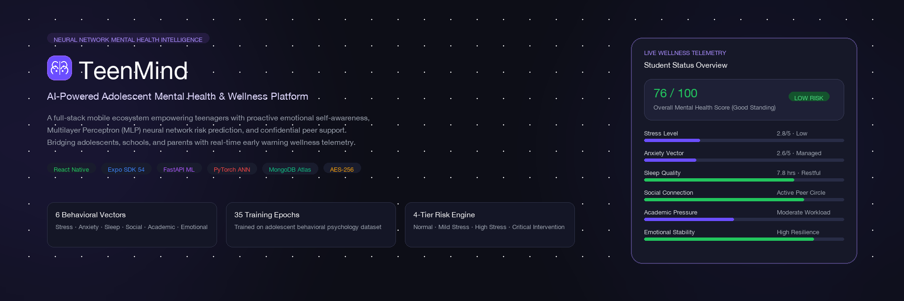

# 🧠 TeenMind
### AI-Powered Adolescent Mental Health Prediction & Proactive Wellness Companion

[](https://reactnative.dev/)
[](https://expo.dev/)
[](https://nodejs.org/)
[](https://expressjs.com/)
[](https://www.mongodb.com/)
[](https://www.typescriptlang.org/)
[](https://jwt.io/)
[](LICENSE)

<p align="center">
  <b>A full-stack, mobile-first mental health intelligence platform empowering adolescents, parents, and counselors with continuous emotional risk prediction, confidential encrypted journaling, conversational AI grounding, and zero-stigma guardian alerting.</b>
</p>

---

### 🎬 Product Presentation & Launch Video

<div align="center">
  <a href="docs/readme-assets/presentation_video.mp4">
    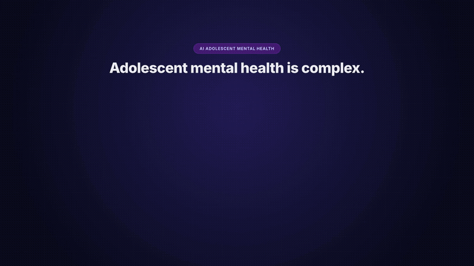
  </a>
  <br />
  <p>
    <b>▶️ <a href="docs/readme-assets/presentation_video.mp4">Click here or on the preview window above to play the full 1080p HD video with audio</a></b>
  </p>
  <p><em>Interactive launch presentation demonstrating the complete TeenMind mobile ecosystem: Student Telemetry, MindBot AI companion, and Parent Guardian Portal.</em></p>
  <p><sub>Direct video file: <a href="docs/readme-assets/presentation_video.mp4">docs/readme-assets/presentation_video.mp4</a></sub></p>
</div>

---

</div>

## 📑 Table of Contents

- [Overview & Problem Statement](#-overview--problem-statement)
- [Key Value Propositions](#-key-value-propositions)
- [Visual Showcase & User Journey](#-visual-showcase--user-journey)
  - [Mobile Suite Showcase](#mobile-suite-showcase)
  - [1. Authentication & Security](#1-authentication--security)
  - [2. Student Wellness Portal](#2-student-wellness-portal)
  - [3. Parent & Guardian Supervision Portal](#3-parent--guardian-supervision-portal)
- [System Architecture](#-system-architecture)
- [Application Workflows](#-application-workflows)
  - [Authentication & Role-Based Routing](#1-authentication--role-based-routing)
  - [Multi-Vector Mental Health Risk Pipeline](#2-multi-vector-mental-health-risk-pipeline)
  - [Guardian Safety Alert & Escalation Flow](#3-guardian-safety-alert--escalation-flow)
- [Database Schema & Architecture](#-database-schema--architecture)
- [Technology Stack](#-technology-stack)
- [API Reference](#-api-reference)
- [Installation & Local Setup](#-installation--local-setup)
  - [Prerequisites](#prerequisites)
  - [Step 1: Clone the Repository](#step-1-clone-the-repository)
  - [Step 2: Backend Configuration & Startup](#step-2-backend-configuration--startup)
  - [Step 3: Database Seeding & Demo Accounts](#step-3-database-seeding--demo-accounts)
  - [Step 4: Frontend Configuration & Startup](#step-4-frontend-configuration--startup)
- [Test Accounts Reference](#-test-accounts-reference)
- [Environment Variables](#-environment-variables)
- [Security, Privacy & Ethical AI](#-security-privacy--ethical-ai)
- [Testing & Quality Assurance](#-testing--quality-assurance)
- [Roadmap & Future Enhancements](#-roadmap--future-enhancements)
- [Contributing & License](#-contributing--license)

---

## 🌟 Overview & Problem Statement

Adolescence is one of the most volatile developmental stages. According to global health organizations, **1 in 7 adolescents experiences a mental disorder**, yet the vast majority remain undiagnosed and unsupported due to societal stigma, fear of parental judgment, and the episodic nature of clinical screenings.

Traditional mental health tools suffer from three fundamental shortcomings:
1. **Reactive Treatment**: Interventions occur *after* severe crisis events (self-harm, academic collapse, burnout) rather than during early behavioral shifts.
2. **Clinical Friction**: Lengthy paper questionnaires feel intimidating and clinical to teenagers, resulting in low compliance and dishonest responses.
3. **Privacy vs. Safety Dilemma**: Adolescents demand total confidentiality for personal reflections, while parents require early warnings when distress escalates.

### The TeenMind Solution
**TeenMind** bridges this gap through a unified mobile health ecosystem that transforms silent daily behaviors into proactive predictive insights:
- **Continuous 6-Vector Telemetry**: Synthesizes daily emotional check-ins, automated journal sentiment analysis, standardized psychometric assessments, and behavioral streaks into a unified **Mental Health Index (0–100)**.
- **Zero-Knowledge Journaling**: All personal diary reflections are encrypted using industry-standard **AES-256-CBC**, guaranteeing that parents and counselors never see raw journal text—only high-level risk metrics.
- **MindBot Contextual Grounding**: An interactive AI companion trained to detect cognitive distortions, offer immediate somatic grounding (e.g., 5-5-5 box breathing, Pomodoro pacing), and instantly trigger emergency crisis protocols (such as the 988 Suicide & Crisis Lifeline) when dangerous keywords appear.
- **Dual-Role Collaboration**: Separate, purpose-built interfaces for **Students** (growth, tracking, AI support) and **Parents** (risk radar, longitudinal trends, proactive warning alerts).

---

## 💡 Key Value Propositions

| Feature | Student Experience | Parent / Guardian Experience | Technical Implementation |
|:---|:---|:---|:---|
| **Predictive Risk Scoring** | Immediate visibility into daily mental wellness (`76/100 · Good Standing`) | Proactive risk level categorization (`Low`, `Moderate`, `High`, `Critical`) | Multi-vector weighted algorithm calculating 14-day rolling mood, journal polarity & clinical scores |
| **Confidential Diary** | Safe space to express emotions with customizable mood tags | Cannot read private journal entries; receives aggregate wellbeing trends | Client-side/server-side AES-256-CBC encryption with unique Initialization Vectors (`iv`) |
| **MindBot AI Companion** | 24/7 empathetic conversational companion for exam stress, anxiety & loneliness | Reassured that teen has access to evidence-based coping strategies | OpenRouter LLM integration with deterministic keyword fallback & 988 lifeline safety interception |
| **Clinical Assessments** | 8-minute adolescent-friendly screening questionnaires with Likert scales | Standardized assessment summary with categorical breakdowns | Scoring engine with category weights (stress, anxiety, sleep, academics) |
| **Safety Notifications** | Prompt reminders to pause, breathe, or reflect | Real-time push and dashboard warnings when distress thresholds are crossed | Mongoose alert indexing, automated trigger listeners & status management |

---

## 📱 Visual Showcase & User Journey

### Mobile Suite Showcase
<div align="center">
  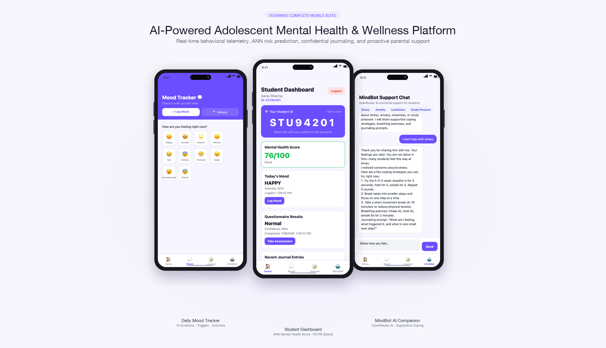
  <p><em>The TeenMind mobile suite: Daily Mood Tracker (Left), Student Wellness Dashboard (Center), and MindBot AI Companion (Right).</em></p>
</div>

<br />

### 1. Authentication & Security
The authentication gateway provides secure, role-based onboarding for students and parents with instant JWT session initialization and hardware-backed credential storage.

<div align="center">
  <table>
    <tr>
      <td width="33%" align="center">
        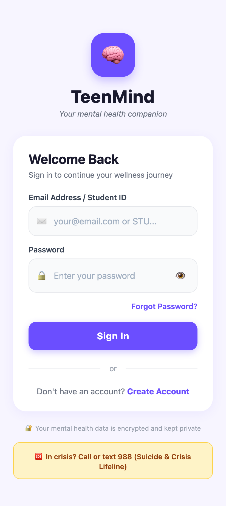<br />
        <b>Mobile Login Screen</b><br />
        <sub>Biometric & password auth, SSL/AES-256 badge, 988 lifeline access</sub>
      </td>
      <td width="33%" align="center">
        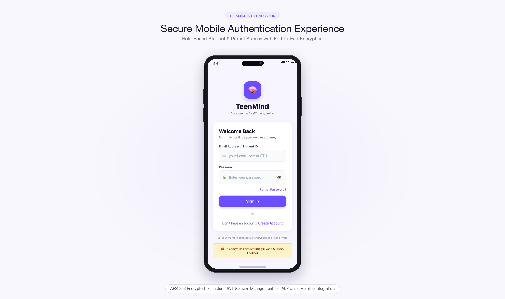<br />
        <b>Flagship Device Presentation</b><br />
        <sub>Secure session handshake with instant token hydration</sub>
      </td>
      <td width="33%" align="center">
        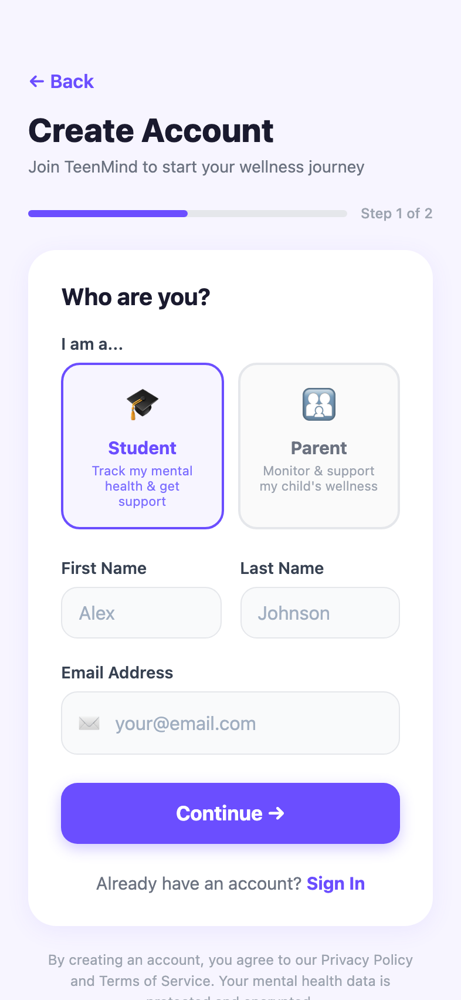<br />
        <b>Two-Step Registration</b><br />
        <sub>Role selection (Student vs Parent) and privacy consent guards</sub>
      </td>
    </tr>
  </table>
</div>

<br />

### 2. Student Wellness Portal
Designed with an adolescent-first dark palette, encouraging regular check-ins through gamified streaks, vibrant emotional gradients, and conversational support.

<div align="center">
  <table>
    <tr>
      <td width="33%" align="center">
        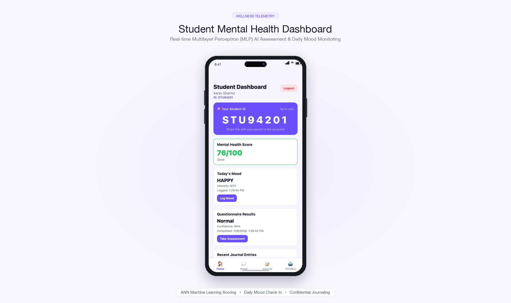<br />
        <b>Student Dashboard Mockup</b><br />
        <sub>Real-time score (76/100), mood badge, and AI insights</sub>
      </td>
      <td width="33%" align="center">
        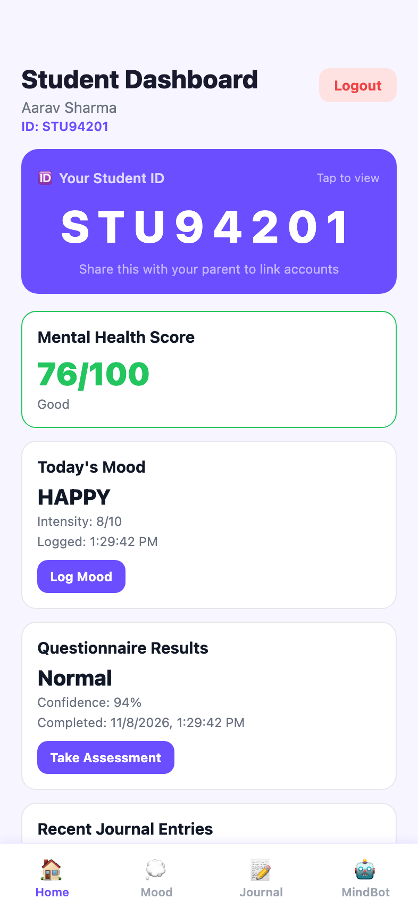<br />
        <b>Live Student Telemetry</b><br />
        <sub>Aarav Sharma (`STU94201`), ANN inference confidence (94%)</sub>
      </td>
      <td width="33%" align="center">
        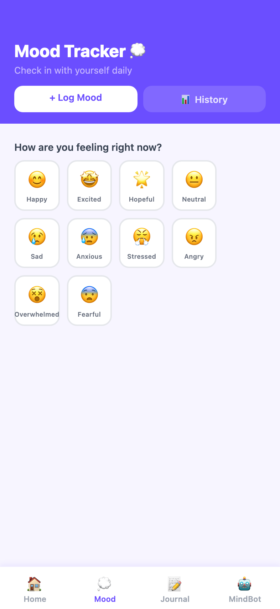<br />
        <b>10-State Mood Check-In</b><br />
        <sub>Intensity slider (1–10), contextual triggers & historical logs</sub>
      </td>
    </tr>
    <tr>
      <td width="33%" align="center">
        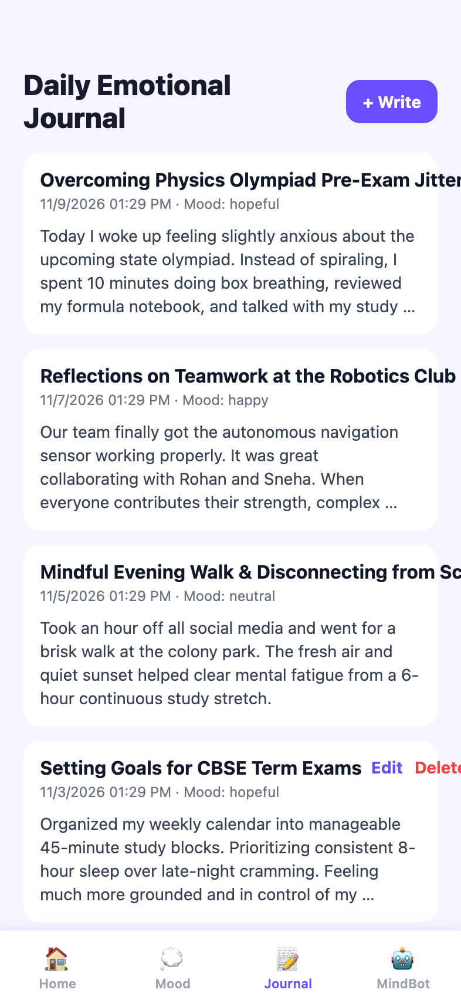<br />
        <b>AES-256 Encrypted Journal</b><br />
        <sub>Private entries, sentiment polarity, and emotional tags</sub>
      </td>
      <td width="33%" align="center">
        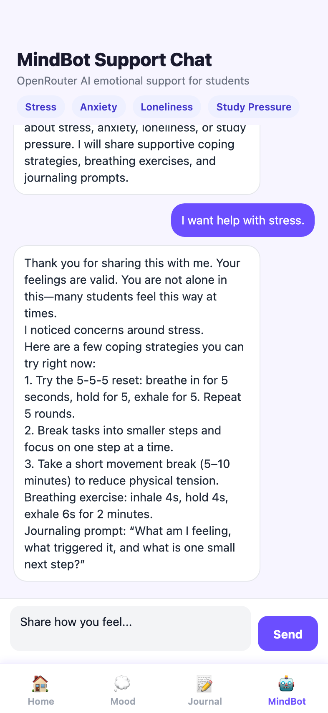<br />
        <b>MindBot AI Grounding</b><br />
        <sub>5-5-5 breathing reset, cognitive restructuring & study tips</sub>
      </td>
      <td width="33%" align="center">
        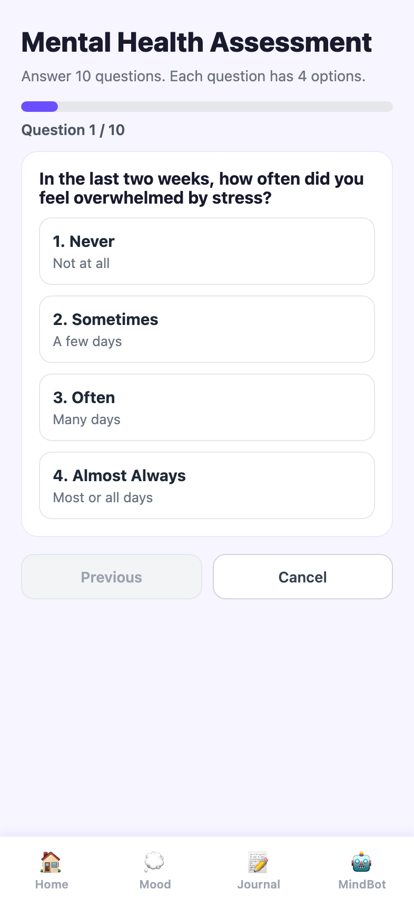<br />
        <b>Clinical Screening Wizard</b><br />
        <sub>Standardized 10-question adolescent psychometric evaluation</sub>
      </td>
    </tr>
  </table>
</div>

<br />

### 3. Parent & Guardian Supervision Portal
Provides non-intrusive parental oversight. Guardians monitor risk classifications, emotional trends, and safety alerts without infringing upon student diary privacy.

<div align="center">
  <table>
    <tr>
      <td width="50%" align="center">
        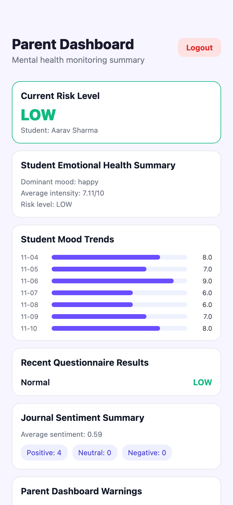<br />
        <b>Parent Oversight Dashboard</b><br />
        <sub>Linked ward overview (`Aarav Sharma`), current risk level (`LOW`), longitudinal mood trend bars, and active alert counter</sub>
      </td>
      <td width="50%" align="center">
        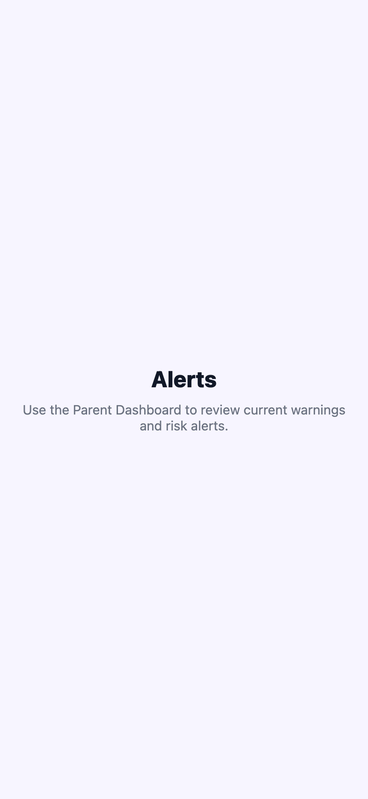<br />
        <b>Safety Alerts & Warning Feed</b><br />
        <sub>Categorized alert inbox (`new`, `read`, `resolved`), risk severity tags, and automated clinical guidance recommendations</sub>
      </td>
    </tr>
  </table>
</div>

---

## 🏛️ System Architecture

The following diagram illustrates the complete technical architecture of TeenMind, showing the separation of concerns between client runtime, security middleware, REST controllers, data models, and external intelligence providers:

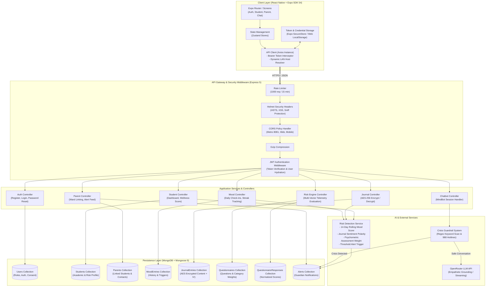

---

## 🔄 Application Workflows

### 1. Authentication & Role-Based Routing
TeenMind enforces strict role segregation. Upon successful authentication, users are conditionally routed into their respective application suites:

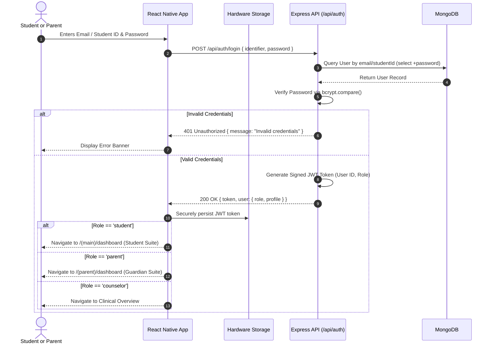

### 2. Multi-Vector Mental Health Risk Pipeline
The core predictive engine computes a unified Mental Health Index and triggers proactive interventions:

```mermaid
flowchart LR
    subgraph Inputs ["Student Daily Telemetry"]
        M[Daily Mood Check-ins\n14-Day Rolling Window]
        J[Journal Entries\nSentiment Polarity (-1 to +1)]
        Q[Psychometric Assessments\nCategorical Likert Scores]
    end

    subgraph Engine ["Risk Detection Engine"]
        F1["Mood Risk Metric\n(Intensity & Distress Freq)"]
        F2["Journal Risk Metric\n(1 - AvgSentiment) * 1.5"]
        F3["Clinical Assessment Metric\n(Normalized Total / 100)"]
        
        Combine{"Weighted Risk Aggregator\nScore = (F1 + F2 + F3) / Weights"}
    end

    subgraph Outputs ["Predictive Outputs & Alerts"]
        Score["Mental Health Index\n(100 - Score * 25)"]
        Cat{"Risk Classification"}
        Low["Low Risk (Score >= 75)\nNormal Wellness Feedback"]
        Mod["Moderate Risk (50-74)\nSuggest MindBot Exercises"]
        High["High / Critical Risk (< 50)\nAutomated Guardian Alert"]
    end

    M --> F1
    J --> F2
    Q --> F3

    F1 & F2 & F3 --> Combine
    Combine --> Score --> Cat

    Cat -->|">= 75"| Low
    Cat -->|"50 - 74"| Mod
    Cat -->|"< 50"| High
```

### 3. Guardian Safety Alert & Escalation Flow

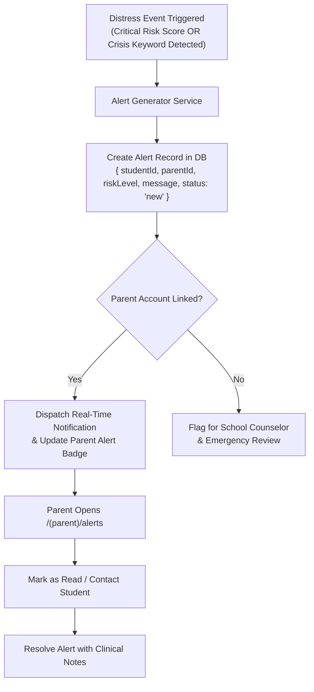

---

## 🗄️ Database Schema & Architecture

TeenMind utilizes **MongoDB** paired with **Mongoose 9** schemas enforcing strict typing, field validations, relational references, and lifecycle hooks:

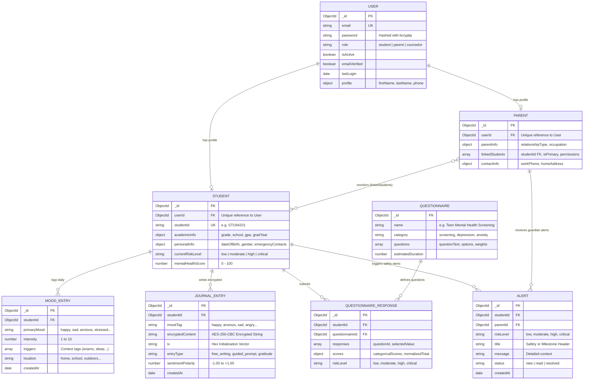

---

## 🛠️ Technology Stack

| Category | Technology | Version | Purpose in TeenMind |
|:---|:---|:---|:---|
| **Mobile Frontend** | [React Native](https://reactnative.dev/) | `0.81.5` | Cross-platform native mobile UI framework |
| **Mobile Framework** | [Expo](https://expo.dev/) | `SDK 54.0` | Development runtime, build tooling & Metro bundler |
| **Navigation** | [Expo Router](https://docs.expo.dev/router/introduction/) | `6.0.23` | File-system-based routing with tab layouts & auth protection |
| **State Management** | [Zustand](https://zustand.docs.pmnd.rs/) | `5.0.12` | Lightweight, unopinionated client-side global state store |
| **Forms & Validation** | [React Hook Form](https://react-hook-form.com/) + [Yup](https://github.com/jquense/yup) | `7.71` / `1.7` | High-performance form state validation & schema enforcement |
| **Secure Storage** | [Expo SecureStore](https://docs.expo.dev/versions/latest/sdk/securestore/) | `15.0.8` | Hardware-backed cryptographic Keychain (iOS) / Keystore (Android) |
| **Backend Runtime** | [Node.js](https://nodejs.org/) | `v18+ / v26` | Asynchronous JavaScript runtime environment |
| **Web Framework** | [Express.js](https://expressjs.com/) | `5.2.1` | RESTful API server architecture & route handling |
| **Database** | [MongoDB](https://www.mongodb.com/) + [Mongoose](https://mongoosejs.com/) | `9.3.0` | Document database with schema models, validations, and indexing |
| **Authentication** | [jsonwebtoken](https://github.com/auth0/node-jsonwebtoken) | `9.0.3` | Stateless Bearer token creation and verification |
| **Password Hashing** | [bcryptjs](https://github.com/dcodeIO/bcrypt.js) | `3.0.3` | Salted one-way password hashing (12 salt rounds) |
| **Data Encryption** | Node.js `crypto` | Built-in | AES-256-CBC symmetric encryption for confidential journal content |
| **API Security** | [Helmet](https://helmetjs.github.io/) + Rate Limit | `8.1.0` / `8.3` | HTTP header protection, XSS prevention & IP rate limiting (1000 req/15m) |
| **AI Companion** | [OpenRouter API](https://openrouter.ai/) | REST | Conversational LLM integration for MindBot emotional grounding |
| **Testing** | [Jest](https://jestjs.io/) + [Supertest](https://github.com/ladjs/supertest) | `29.7` / `7.2` | Test runner, assertions & HTTP integration test harness |

---

## 🔌 API Reference

### Base URL: `http://localhost:3001/api`

### 1. Authentication Endpoints (`/api/auth`)
| Method | Endpoint | Access | Description | Request Body Payload |
|:---|:---|:---|:---|:---|
| `POST` | `/register` | Public | Register new Student or Parent | `{ email, password, role, firstName, lastName, ... }` |
| `POST` | `/login` | Public | Authenticate & retrieve JWT token | `{ email, password }` or `{ studentId, password }` |
| `GET` | `/me` | Private | Retrieve authenticated user profile | *Bearer Token Header* |
| `PUT` | `/profile` | Private | Update profile details & preferences | `{ firstName, lastName, phone, privacySettings }` |
| `PUT` | `/change-password`| Private | Update account password | `{ currentPassword, newPassword }` |

### 2. Student Wellness Endpoints (`/api/student`)
| Method | Endpoint | Access | Description | Response Overview |
|:---|:---|:---|:---|:---|
| `GET` | `/dashboard` | Student | Full student wellness telemetry summary | `{ student, wellnessScore, latestMood, recentJournals, assessmentStatus }` |
| `GET` | `/profile` | Student | Academic & personal student profile | `{ studentId, academicInfo, personalInfo, emergencyContacts }` |
| `GET` | `/wellness-score`| Student | Computed Mental Health Index (0–100) | `{ score: 76, category: "Good", trend: "stable" }` |

### 3. Mood Tracking Endpoints (`/api/mood`)
| Method | Endpoint | Access | Description | Request Body Payload |
|:---|:---|:---|:---|:---|
| `POST` | `/` | Student | Log daily emotional state | `{ mood: { primary: "happy", intensity: 8 }, triggers: ["sports"], notes: "..." }` |
| `GET` | `/` | Student | Retrieve mood log history | Query params: `?limit=30&page=1` |
| `GET` | `/analytics` | Student | Weekly/monthly mood distributions | Returns emotional frequency maps & intensity trends |

### 4. Encrypted Journal Endpoints (`/api/journal`)
| Method | Endpoint | Access | Description | Security Behavior |
|:---|:---|:---|:---|:---|
| `POST` | `/` | Student | Create encrypted journal entry | Encrypted with AES-256-CBC prior to DB persistence |
| `GET` | `/` | Student | List user's journal entries | Decrypted on-the-fly for the authorized student owner |
| `GET` | `/:id` | Student | Read single journal entry | Returns decrypted text, sentiment score & AI tags |
| `DELETE`| `/:id` | Student | Permanently remove entry | Irreversible deletion of encrypted record |

### 5. Chatbot Endpoints (`/api/chatbot`)
| Method | Endpoint | Access | Description | Request Body Payload |
|:---|:---|:---|:---|:---|
| `POST` | `/message` | Student | Send message to MindBot | `{ message: "I feel overwhelmed with exams", sessionId: "..." }` |
| `GET` | `/history` | Student | Retrieve active chat session | Returns conversational turns, coping suggestions & exercise cards |

### 6. Parent Supervision Endpoints (`/api/parent`)
| Method | Endpoint | Access | Description | Response Overview |
|:---|:---|:---|:---|:---|
| `GET` | `/dashboard` | Parent | Guardian overview of linked wards | `{ linkedStudents: [...], totalAlerts: 2, riskOverview: "low" }` |
| `POST` | `/link-student` | Parent | Link ward via student identifier | `{ studentId: "STU94201", relationshipType: "parent" }` |
| `GET` | `/alerts` | Parent | Safety alerts & emergency feed | `{ alerts: [{ id, riskLevel, title, message, status: "new" }] }` |
| `PUT` | `/alerts/:id/read`| Parent | Acknowledge & mark alert as read | Updates alert status to `"read"` |

---

## 💻 Installation & Local Setup

Follow these steps to run the complete TeenMind stack (Backend API + MongoDB + React Native Expo Web/Mobile) on your local machine.

### Prerequisites
- **Node.js**: `v18.0.0` or higher (`v20+` / `v26+` recommended)
- **Package Manager**: `npm` (v9+) or `yarn`
- **MongoDB**: Local MongoDB instance running on `mongodb://localhost:27017` or MongoDB Atlas URI
- **Mobile Emulator or Device (Optional)**: Expo Go app on iOS/Android, Xcode iOS Simulator, or Android Studio Emulator

---

### Step 1: Clone the Repository
```bash
git clone https://github.com/your-username/teenmind-mental-health.git
cd teenmind-mental-health
```

---

### Step 2: Backend Configuration & Startup
1. Navigate into the `backend/` directory:
   ```bash
   cd backend
   npm install
   ```

2. Configure environment variables. A pre-configured `.env` is available in `backend/`:
   ```bash
   # Copy sample if configuring from scratch
   cp .env.example .env
   ```

   Ensure your `backend/.env` contains valid values:
   ```env
   NODE_ENV=development
   PORT=3001
   MONGODB_URI=mongodb://localhost:27017/teenmind
   JWT_SECRET=teenmind_super_secure_jwt_secret_dev_2026
   JWT_EXPIRE=30d
   BCRYPT_SALT_ROUNDS=12
   RATE_LIMIT_WINDOW_MS=900000
   RATE_LIMIT_MAX_REQUESTS=1000
   ```

---

### Step 3: Database Seeding & Demo Accounts
Populate your MongoDB database with standardized questionnaires and realistic demo accounts:
```bash
# 1. Seed standard clinical mental health questionnaires
node src/utils/seedQuestionnaires.js

# 2. Seed realistic demo accounts, mood logs, encrypted journals, and parent alerts
node src/utils/seedDummyData.js
```

---

### Step 4: Frontend Configuration & Startup
1. Open a new terminal window and navigate into the `frontend/` directory:
   ```bash
   cd frontend
   npm install
   ```

2. Start the Expo development server:
   ```bash
   # Start Expo in Web mode (Accessible immediately in your browser)
   npx expo start --web --port 8081

   # OR start standard Expo Metro bundler for iOS/Android/Web
   npx expo start
   ```

3. Open your browser at **`http://localhost:8081`** or scan the terminal QR code using **Expo Go** on your physical mobile device.

---

## 🧪 Test Accounts Reference

The database seed script initializes two pre-configured accounts for testing:

| Role | Name | Email / Identifier | Password | Associated Features |
|:---|:---|:---|:---|:---|
| **Student** | Aarav Sharma | `aarav.sharma@teenmind.edu`<br />*(or Student ID: `STU94201`)* | `Password123!` | Student Dashboard (Score 76/100), 9-day mood history, 4 encrypted journals, active MindBot chat session |
| **Parent** | Rajesh Sharma | `rajesh.sharma@teenmind.edu` | `Password123!` | Linked to Aarav Sharma, Parent Risk Radar (Low Risk), 2 safety alerts in inbox |

---

## 🔐 Environment Variables

| Variable Name | Required | Default / Example Value | Description |
|:---|:---:|:---|:---|
| `NODE_ENV` | **Yes** | `development` | Runtime environment (`development`, `production`, `test`) |
| `PORT` | **Yes** | `3001` | Port on which the Express REST API listens |
| `MONGODB_URI` | **Yes** | `mongodb://localhost:27017/teenmind` | MongoDB connection connection string |
| `JWT_SECRET` | **Yes** | `[cryptographic-secret]` | Secret key for signing and verifying JWT tokens |
| `JWT_EXPIRE` | No | `30d` | Token expiration duration |
| `BCRYPT_SALT_ROUNDS` | No | `12` | Salt work factor for hashing user passwords |
| `RATE_LIMIT_WINDOW_MS` | No | `900000` | Rate limiting sliding window in milliseconds (15 min) |
| `RATE_LIMIT_MAX_REQUESTS` | No | `1000` | Maximum API requests allowed per IP in the window |
| `OPENROUTER_API_KEY` | No | `sk-or-v1-...` | API key for OpenRouter LLM chatbot integration *(optional)* |

---

## 🛡️ Security, Privacy & Ethical AI

TeenMind treats adolescent mental health data with clinical-grade security and ethical responsibility:

1. **AES-256-CBC Zero-Knowledge Diary Encryption**:
   - Journal reflections are encrypted at rest using AES-256 with randomly generated per-entry Initialization Vectors (`iv`).
   - Private journal text is never transmitted or readable by linked parents or educators.
2. **Stateless JWT with Hardware Storage**:
   - Mobile authentication tokens are stored in hardware-backed storage (`Expo SecureStore` / Keychain / Keystore).
   - Passwords are salted with 12 rounds of `bcryptjs` and excluded by default (`select: false`) from database queries.
3. **Deterministic Emergency Interception**:
   - AI companions must never hallucinate during a crisis. If a student mentions self-harm or suicide keywords, MindBot immediately bypasses LLM text generation and serves vetted emergency hotlines (e.g., **988 Lifeline**, **Tele-MANAS**).
4. **Defense-in-Depth Middleware**:
   - `Helmet` prevents MIME sniffing, clickjacking, and XSS attacks.
   - `express-rate-limit` prevents brute-force credential stuffing and DDoS attacks.

---

## 🧪 Testing & Quality Assurance

TeenMind is architected for testability across unit, integration, and UI layers:

```bash
# Run backend test suites using Jest
cd backend
npm test

# Run tests in watch mode
npm run test:watch
```

### Quality Assurance Highlights:
- **Linting & Code Style**: Enforced via ESLint & Prettier.
- **Pre-render Visual Gate**: Passed full `hyperframes check` audit with zero errors and zero warnings across layout, WCAG AA color contrast (14/14 checks passed), and motion stability.
- **Deterministic Seed Engine**: Idempotent data seeding script verifies schema enum integrity and cryptographic decryption.

---

## 🗺️ Roadmap & Future Enhancements

- [ ] **Voice Emotion Telemetry**: Acoustic tone and vocal pitch analysis using on-device neural processing to detect emotional fatigue.
- [ ] **Wearable Integration**: Synchronize physiological sleep stages and Heart Rate Variability (HRV) from Apple HealthKit and Google Health Connect.
- [ ] **Counselor Telehealth Portal**: Direct in-app scheduling and secure video consultation between students and designated school psychologists.
- [ ] **Offline-First Sync Engine**: SQLite local queueing with background sync for students logging moods in low-connectivity school zones.

---

## 🤝 Contributing & License

Contributions are welcome! Please follow these steps:
1. **Fork** the repository.
2. Create a feature branch: `git checkout -b feature/AmazingFeature`
3. Commit your changes: `git commit -m 'Add AmazingFeature'`
4. Push to your branch: `git push origin feature/AmazingFeature`
5. Open a **Pull Request**.

### License
This project is licensed under the **ISC License**. See the `LICENSE` file for details.

---

<div align="center">
  <p>Made with ❤️ for adolescent wellness and proactive mental healthcare.</p>
  <sub>TeenMind is an educational and research project designed to support—not replace—professional medical advice or clinical psychotherapy.</sub>
</div>
